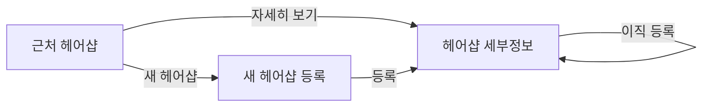

# PRD — 꽃사슴
- 상태 : 완성
- 한 줄 정의 : 디자이너를 중심으로 한 커리어·포트폴리오·팔로우 기반 미용 지도

## 1. 문제
### 배경
즐겨찾는 디자이너를 잃은 고객은 머리하러 갈 때 찾는 디자이너가 갑자기 사라지면, 보통 한 디자이너한테만 머리를 자르기 때문에 기존 디자이너를 찾기 어렵다. 현재는 네이버 예약 사진을 보고 다른 디자이너로 예약한다.

### 목표
디자이너가 새 헤어샵 이름과 연락처를 등록하면 예전 고객이 디자이너의 새 소속을 확인할 수 있게 한다.

## 2. 사용자
### 페르소나
- 즐겨찾는 디자이너를 잃은 고객
- 이직을 앞 둔 디자이너

### 사용자 스토리
- 이직을 앞 둔 디자이너로서, 새 헤어샵 이름과 연락처를 등록하고 싶다. 예전 고객이 새 소속을 확인할 수 있게 하기 위해서다.
- 이직을 앞 둔 디자이너로서, 헤어샵을 지도에 등록하고 싶다. 다른 디자이너들이 소속 헤어샵로 사용할 수 있게 하기 위해서다.

## 3. 범위
### 넣을 기능
1. 디자이너가 헤어샵을 지도에 등록하고 다른 디자이너들이 소속 헤어샵로 사용할 수 있다.
2. 디자이너가 새 헤어샵 이름과 연락처를 등록하면 예전 고객이 새 소속을 확인할 수 있다.

### 기능 요구사항
- 새 헤어샵 이름, 연락처, 지도 위치를 입력하고 등록을 누르면 등록한 헤어샵 1개의 이름과 위치가 지도에 표시된다.
- 헤어샵 세부정보에서 이직 등록을 누르면 디자이너의 새 소속 헤어샵을 등록할 수 있다.
- 모든 사용자는 각자의 대시보드를 갖고, 디자이너 대시보드에는 포트폴리오와 헤어샵 관리 기능이 있다.
- 디자이너 대시보드의 헤어샵 관리에서 내가 만든 헤어샵에 등록을 요청한 디자이너의 메시지를 확인할 수 있다.

### 비목표
- 디자이너의 헤어스타일 사진 등록과 고객의 다른 디자이너 비교는 이번 범위에서 제외한다. 디자이너의 헤어스타일 사진 비교 기능은 뺄 기능으로 정해져 있기 때문이다.
- 고객의 디자이너 즐겨찾기와 다음 방문 시 바로 찾기는 이번 범위에서 제외한다. 고객 즐겨찾기 기능은 뺄 기능으로 정해져 있기 때문이다.
- 디자이너 정보의 예약 링크 등록과 새 헤어샵 바로 예약은 이번 범위에서 제외한다. 예약 링크 기능은 뺄 기능으로 정해져 있기 때문이다.
- 고객이 디자이너의 이름과 기존 헤어샵을 등록해 찾는 데 도움을 받는 기능은 이번 범위에서 제외한다. 디자이너 찾기 도움 기능은 뺄 기능으로 정해져 있기 때문이다.

## 4. 화면
### 사용자 흐름
- 근처 헤어샵 : 등록된 헤어샵 목록과 지도 위치를 확인하고, 새 헤어샵 등록 또는 헤어샵 세부정보로 이동한다.
- 새 헤어샵 등록: 헤어샵 이름, 연락처, 지도 위치를 입력하고 등록한다.
- 헤어샵 세부정보: 헤어샵 정보와 소속 디자이너를 확인하고 이직 등록으로 이동한다.
- 사용자 대시보드: 모든 사용자가 각자의 대시보드를 가지며, 디자이너는 포트폴리오와 헤어샵 관리를 함께 사용하고 등록 요청 메시지를 확인한다.

## 5. 완성 기준
### 수용 기준
- `새 헤어샵 등록`에서 헤어샵 이름, 연락처, 지도 위치를 넣고 `등록`을 누르면 -> `헤어샵 세부정보`에 등록한 헤어샵 1개의 이름과 위치가 보인다.
- `헤어샵 세부정보`에서 `이직 등록`을 누르면 -> 해당 헤어샵의 소속 디자이너 목록에 등록된다.
- `새 헤어샵 등록`에서 헤어샵 이름, 연락처, 지도 위치를 넣고 `등록`을 누르면 -> `헤어샵 세부정보`에 등록한 헤어샵 정보가 보인다. `헤어샵 세부정보`에서 `이직 등록`을 누르면 -> `헤어샵 세부정보`에 소속 디자이너 정보가 보인다.
- `사용자 대시보드`에서 `포트폴리오`를 누르면 -> 포트폴리오가 보이고, `헤어샵 관리`를 누르면 -> 등록을 요청한 디자이너의 메시지가 보인다.

테스트

